<p align="center">
  
</p>

<p align="center">
  
</p>

<p align="center">
  <a href="mailto:vermakshitij747@gmail.com"></a>
  <a href="https://www.linkedin.com/in/YOUR-LINKEDIN-SLUG/"></a>
  <a href="https://codeforces.com/profile/kv777"></a>
  
</p>


## 🏆 Featured — Google Cloud Rapid Agent Hackathon 2026

<p align="center">
  <a href="https://github.com/SirjanSingh/cassandra"></a>
  <br/><sub>🥇 1st place, Arize track · 14,000+ participants · $5,000 · built with <a href="https://github.com/SirjanSingh">@SirjanSingh</a> &nbsp;◆&nbsp; <a href="https://github.com/SirjanSingh/cassandra">code</a></sub>
</p>


## 👨‍💻 About me

<table>
<tr>
<td width="55%" valign="top">

```python
class Kshitij:
    role      = "ML Engineer @ Surveyors AI"
    studies   = "B.Tech CCE @ LNMIIT Jaipur ('28)"
    building  = ["CV for insurance claims",
                 "LLM agent observability",
                 "telematics risk scoring"]
    previously = ["AI Engineering Intern @ Gnani.ai",
                  "Mentor & Organizer @ Mentox"]
    after_dark = "Coordinator, LNMIIT Astronomy Club 🔭"
    open_to    = "Summer 2027 ML / AI internships"
```

</td>
<td width="45%" valign="top">

**🏅 Wins**

| | |
|:-:|:--|
| 🥇 | Google Cloud Rapid Agent Hackathon — **1st / 14,000+** |
| 🥇 | HackCrux 36-hr — **Winner** (telematics) |
| 🥇 | Space IDEATHON — **1st** |
| 🥈 | Space Hackathon — **2nd** |
| 🏁 | Control+Space — **4th** |
| ✅ | Smart India Hackathon — R1 qualified |

</td>
</tr>
</table>


## 🚀 Things I built

<table>
<tr>
<td width="50%" valign="top"><br/><sub>ISRO / NNRMS hackathon · SegFormer · clDice · NetworkX</sub></td>
<td width="50%" valign="top"><a href="https://github.com/Ksh1tij777/Car_Behaviour"></a><br/><sub>UAH-DriveSet · Python · scikit-learn &nbsp;◆&nbsp; <a href="https://github.com/Ksh1tij777/Car_Behaviour">code</a></sub></td>
</tr>
</table>

<details>
<summary><b>More projects</b></summary>
<br/>

| | Project | What it does | Stack |
|:-:|---|---|---|
| 🛵 | **Two-wheeler Damage AI** · *private* | Damage segmentation + fraud signals for bike-insurance claims | PyTorch · SegFormer · EfficientNet |
| 🎓 | [**LNMAchieves**](https://github.com/Ksh1tij777/SWE_PROJECT) | Achievement portal with mentor → HOD approval and a public wall | Flask · SQLite |
| 📈 | [**Stock Order Replicator**](https://github.com/Ksh1tij777/Stock_Bot) | Mirrors trades across accounts by watching the order form | Python · Selenium |
| ⚡ | [**Electricity Price Prediction**](https://github.com/Ksh1tij777/Electricity-Price-Prediction) | Random-forest price model served as an API | scikit-learn · FastAPI |

</details>


## 🛠️ Tech stack

<p align="center">
  <br/>
  <br/>
  
</p>

<p align="center">
  
  
  
  
  
  
</p>


## 📊 GitHub stats

<p align="center">
  
</p>

<p align="center">
  
  
</p>

<p align="center">
  
  
</p>

<p align="center">
  
</p>

<details>
<summary><b>🧊 3D contribution calendar · languages · achievements</b> (click to expand)</summary>
<br/>
<p align="center">
  
  
  
  
</p>
</details>


## 🐍 Contribution snake

<p align="center">
  <picture>
    <source media="(prefers-color-scheme: dark)" srcset="https://raw.githubusercontent.com/Ksh1tij777/Ksh1tij777/output/github-snake-dark.svg" />
    <source media="(prefers-color-scheme: light)" srcset="https://raw.githubusercontent.com/Ksh1tij777/Ksh1tij777/output/github-snake.svg" />
    
  </picture>
</p>

<p align="center"><sub>Stats and the snake are rebuilt daily by GitHub Actions in this repo — no third-party servers.</sub></p>
